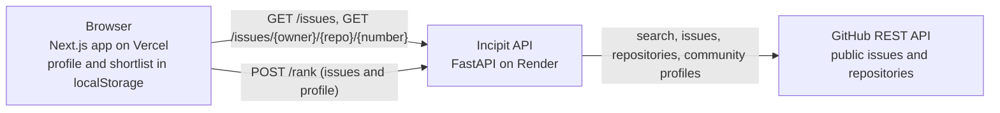

# incipit.

open source is cool until you spend 3 hours looking for one issue you can actually solve. incipit helps you find your starting point, minus the existential crisis.

**Try it:** https://incipit-five.vercel.app


## What it does

Incipit finds open GitHub issues labelled `good first issue`, ranks them for you with a score you can inspect, and gives each one a dossier that separates what GitHub says from what Incipit infers.

- **Live discovery.** Search by keyword, filter by language and task type, or type `owner/repo` (or paste a GitHub link) to see one project's beginner issues. Load up to 100 results, 20 at a time.
- **An explained fit score.** Five signals (language match, task type, description clarity, repository activity, your topics) are combined with published weights. Open "Why this score" to see each signal's points and reason. Assigned issues and busy threads are marked down, with the reason shown. Signals that can't be computed are left out, never guessed.
- **A dossier for every issue.** The issue is checked live on GitHub and shown with a timestamp: state, labels, assignees, comments, the repository's language, stars, last push and licence, and its contributing guide when GitHub reports one. Incipit's own guidance is a separate, clearly labelled general checklist. Closed, deleted, transferred and missing issues each get a clear message.
- **Your profile and shortlist stay in your browser.** Languages, topics and preferred task types personalise the ranking. Saved issues survive a refresh and stay in step across tabs. No account, no tracking.
- **Honest by design.** Incipit never says an issue is easy, unclaimed or likely to be accepted. Nothing needs a paid AI service.

| An issue dossier | On a phone | While searching |
| --- | --- | --- |
|  |  |  |

## How it works



- **`GET /issues`** searches GitHub, then looks up each distinct repository on the page (at most five at a time, cached for 30 minutes). A failed lookup leaves that issue without repository details instead of failing the search.
- **`GET /issues/{owner}/{repo}/{number}`** builds a dossier from the live issue, its repository and its contributing guide.
- **`POST /rank`** scores issues for a profile. It is pure computation, so the profile never appears in a URL or reaches GitHub.

More detail: [architecture](docs/architecture.md), [how the ranking was evaluated](docs/ranking-evaluation.md) and the [roadmap](docs/checkpoints.md).

## Run it locally

You need Node.js 20.9 or newer (CI uses 24) with npm, Python 3.12+ and [uv](https://docs.astral.sh/uv/).

**1. The API.** In one terminal, from the repository root:

```bash
cd services/api
uv sync
uv run uvicorn api.main:app --reload --port 8001
```

Check http://localhost:8001/health. Interactive API docs are at http://localhost:8001/docs.

**2. The web app.** In a second terminal:

```bash
cd apps/web
npm install
```

Create `apps/web/.env.local` containing:

```dotenv
NEXT_PUBLIC_API_BASE_URL=http://localhost:8001
```

Then run `npm run dev` and open http://localhost:3000.

## Configuration

The root [`.env.example`](.env.example) lists every variable. Keep real values in `.env` (ignored by git) and never commit secrets.

| Variable | Where | What it does |
| --- | --- | --- |
| `NEXT_PUBLIC_API_BASE_URL` | web app | The API's address. It is built into the page and into its security policy, so it must never hold a secret. |
| `GITHUB_TOKEN` | API only | Optional locally, practically required when deployed: without it GitHub allows 60 calls an hour, and a page of results can use 21. A fine-grained token with read-only access to public repositories is enough. |
| `ALLOWED_ORIGINS` | API | The web app addresses allowed to call the API from a browser, separated by commas. |
| `GITHUB_REQUESTS_PER_MINUTE`, `RANK_REQUESTS_PER_MINUTE` | API | Per-visitor rate limits (default 60 and 120). |

## Tests and checks

CI runs all of these on every pull request and on `main`:

```bash
# API (from services/api)
uv run ruff check . && uv run ruff format --check .
npx pyright@1.1.390 -p ../../pyrightconfig.json
uv run pytest --cov=api

# web app (from apps/web)
npm run lint && npm run typecheck && npm test && npm run build
```

The API tests include golden-ordering tests on 33 real issues, which fail if the ranking changes by accident. To re-run the ranking evaluation: `uv run python scripts/evaluate_ranking.py report`.

## Deploying

The API deploys to Render from [`render.yaml`](render.yaml) and the web app to Vercel. [docs/deployment.md](docs/deployment.md) walks through it, including the GitHub token, CORS and a smoke test for the live URLs. After that, every merge to `main` redeploys both.

## Security

- The GitHub token lives only on the API server; the browser never sees it.
- Only the web app's own address may call the API from a browser (CORS).
- Each visitor is rate-limited, request bodies are capped at 4 MB, and owner, repository and issue number are validated before anything reaches GitHub.
- Both apps send security headers, including a Content-Security-Policy. The web app's only lets the browser talk to itself and the API.
- Issue text is shown as plain text, and only `https://github.com/` links are rendered.
- Third-party CI actions are pinned to commit SHAs.

## Known limitations

- The score is a heuristic for prioritising, not a measure of difficulty. A long, well-written issue can look clear while being hard ([evaluation](docs/ranking-evaluation.md)).
- Language match uses only the repository's main language as GitHub reports it, and task types come from labels, which are inconsistent.
- One repository can fill several places in the results.
- At most 100 issues are loaded per search.
- The shortlist lives in one browser, isn't synced across devices, and shows each issue's state as it was when saved.
- On the free hosting plan the API sleeps after 15 minutes without visitors; the first search afterwards can take up to a minute, and the page says so.
- Rate limits and caches live in memory, so they reset when the API restarts.

## Project structure

```text
apps/web/            Next.js app (pages in src/app, UI in src/components, logic in src/lib)
services/api/        FastAPI service (src/api), tests and scripts
docs/                Architecture, deployment, ranking evaluation, roadmap, screenshots
render.yaml          Render blueprint for the API
pyrightconfig.json   Type-checking settings (also points VS Code at the API's virtual environment)
```

## License

MIT
