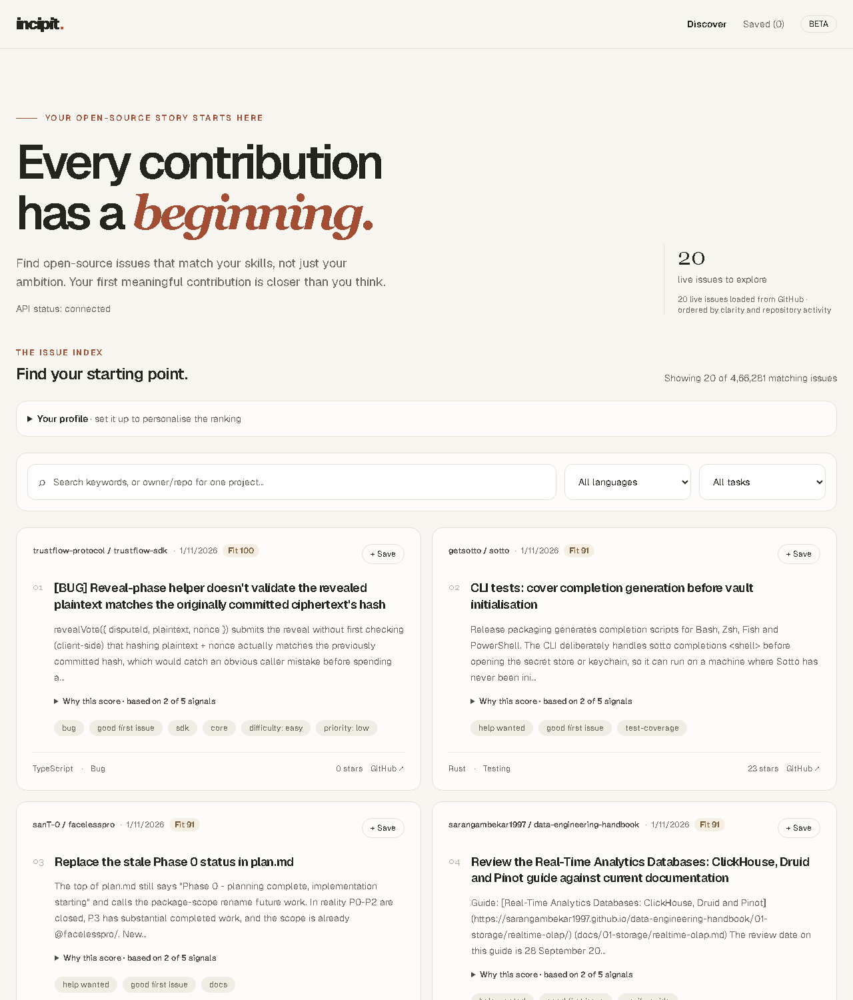
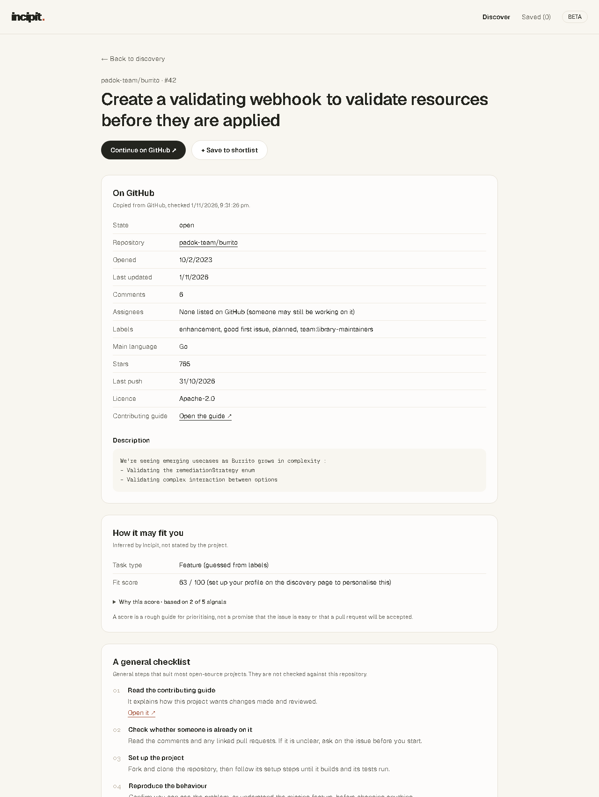
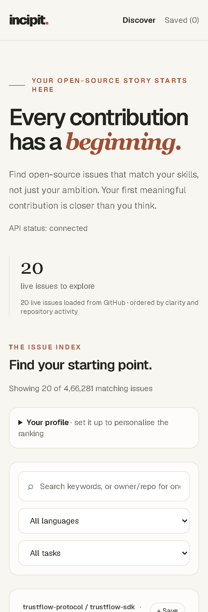
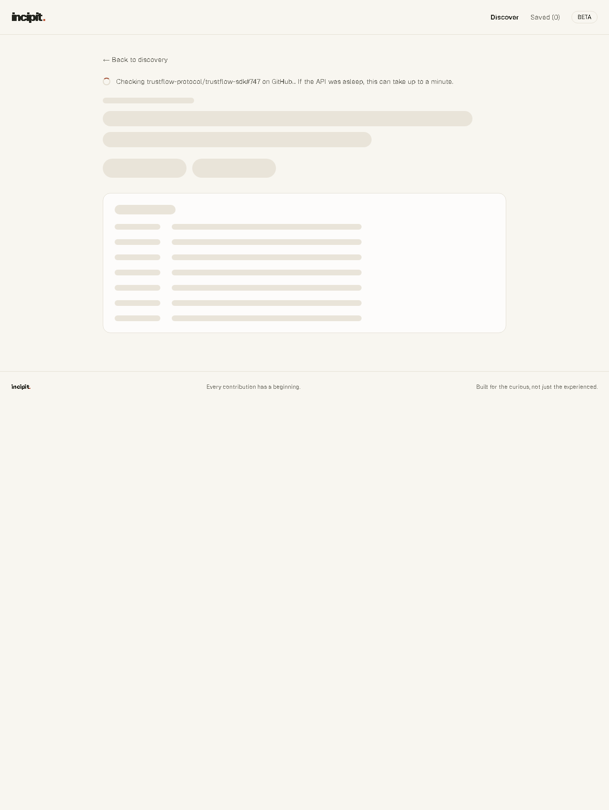
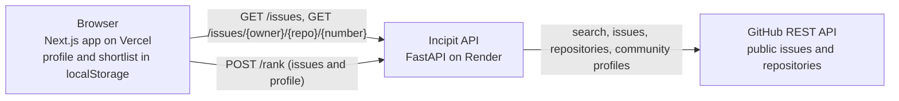

# incipit.

open source is cool until you spend 3 hours looking for one issue you can actually solve. incipit finds `good first issue`s, tells you which ones fit *you*, and shows its working. minus the existential crisis.

**try it:** https://incipit-five.vercel.app

<sub>first visit after a quiet spell? give it up to a minute. the free server is a heavy sleeper, and the page will tell you it's waking up.</sub>



## what it does

- **finds the issues.** Live `good first issue`s from GitHub. Search by keyword, filter by language or task type, or type `owner/repo` (or paste a GitHub link) to see one project's beginner issues. Up to 100 results, 20 at a time.
- **scores them, and shows its working.** Five signals (language match, task type, how clear the write-up is, whether the repo is alive, your topics), combined with published weights. Click "Why this score" for every signal's points and reason. Assigned issues and pile-on threads get marked down, and it says so. Missing data is left out, never guessed: unknown never counts as bad.
- **gives every issue a dossier.** Checked live on GitHub with a timestamp: state, labels, assignees, comments, the repo's language, stars, last push, licence and contributing guide. Incipit's own advice sits in a separate, clearly labelled checklist. Closed, deleted, transferred and missing issues each get a clear message.
- **remembers you, not your data.** Your languages, topics and task types personalise the ranking, and your shortlist survives refreshes and syncs across tabs. Hit "Refresh status" and it re-checks every saved issue on GitHub, so you find out an issue was closed before you've spent an evening on it. It all lives in your browser. No account, no tracking.
- **makes no promises it can't keep.** Incipit never calls an issue easy, unclaimed or likely to be merged. No paid AI anywhere.

| the dossier | on your phone | while it thinks |
| --- | --- | --- |
|  |  |  |

## how it works



- **`GET /issues`** searches GitHub, then looks up each repository on the page (five at a time, cached for 30 minutes). If one lookup fails, that card just goes without repo details; the search doesn't fall over.
- **`GET /issues/{owner}/{repo}/{number}`** builds a dossier from the live issue, its repository and its contributing guide.
- **`POST /rank`** scores issues for a profile. Pure maths, so your profile never ends up in a URL or anywhere near GitHub.

More detail: [architecture](docs/architecture.md), [how the ranking was evaluated](docs/ranking-evaluation.md) and the [roadmap](docs/checkpoints.md).

## is the score any good?

Honest answer: it's a sensible heuristic, not machine learning. Hand-written rules with hand-set weights, every one of them explained on screen.

It was checked against 33 real issues, and that check found two real problems: assigned issues and crowded bounty threads ranked as if they were free. Both now get marked down. But the ratings are an unreviewed first pass that no person has rated yet, and the two rules were measured on the same issues they came from. So treat the numbers as a sanity check, not a benchmark. [The evaluation write-up](docs/ranking-evaluation.md) has the details, the known weak spots, and how to run a fair test. Want to help? `evaluate_ranking.py rate --rater your-name` lets you rate issues blind, with no scores in sight.

## run it locally

You need Node.js 20.9 or newer (CI uses 24) with npm, Python 3.12+ and [uv](https://docs.astral.sh/uv/).

**1. the API.** In one terminal, from the repository root:

```bash
cd services/api
uv sync
uv run uvicorn api.main:app --reload --port 8001
```

http://localhost:8001/health should say it's healthy. Interactive API docs live at http://localhost:8001/docs.

**2. the web app.** In a second terminal:

```bash
cd apps/web
npm install
```

Create `apps/web/.env.local` containing:

```dotenv
NEXT_PUBLIC_API_BASE_URL=http://localhost:8001
```

Then `npm run dev` and open http://localhost:3000. That's it, you're in.

## configuration

The root [`.env.example`](.env.example) lists every variable. Real values go in `.env` (git ignores it). Secrets never get committed, ever.

| variable | where | what it does |
| --- | --- | --- |
| `NEXT_PUBLIC_API_BASE_URL` | web app | The API's address. It's baked into the page and its security policy, so it must never hold a secret. |
| `GITHUB_TOKEN` | API only | Optional locally, practically required when deployed: without it GitHub allows 60 calls an hour, and one page of results can use 21. A fine-grained, read-only token for public repositories is plenty. |
| `ALLOWED_ORIGINS` | API | The web app addresses allowed to call the API from a browser, separated by commas. |
| `GITHUB_REQUESTS_PER_MINUTE`, `RANK_REQUESTS_PER_MINUTE` | API | Per-visitor rate limits (default 60 and 120). |
| `TRUSTED_PROXY_HOPS` | API | How many proxies in front of the API add to `X-Forwarded-For`. 0 locally; `render.yaml` sets 1, so visitors can't fake their way to a fresh rate limit. |

## tests and checks

CI runs all of these on every pull request and on `main`:

```bash
# API (from services/api)
uv run ruff check . && uv run ruff format --check .
npx pyright@1.1.390 -p ../../pyrightconfig.json
uv run pytest --cov=api

# web app (from apps/web)
npm run lint && npm run typecheck && npm test && npm run build
```

The API tests include golden-ordering tests on those 33 real issues: change the ranking by accident and they'll tell on you. To re-run the evaluation: `uv run python scripts/evaluate_ranking.py report`.

## deploying

The API deploys to Render from [`render.yaml`](render.yaml) and the web app to Vercel. [docs/deployment.md](docs/deployment.md) walks through it, including the GitHub token, CORS and a smoke test for the live URLs. After that, every merge to `main` redeploys both. Ship it.

## security

- The GitHub token lives only on the API server. The browser never sees it.
- Only the web app's own address may call the API from a browser (CORS).
- Each visitor is rate-limited by the address Cloudflare reports, not by anything the visitor can fake. Request bodies are capped at 4 MB, and owner, repository and issue number are validated before anything reaches GitHub.
- Both apps send security headers, including a Content-Security-Policy. The web app's only lets the browser talk to itself and the API.
- Issue text is shown as plain text, and the only links rendered are `https://github.com/` ones.
- Third-party CI actions are pinned to commit SHAs, and Dependabot keeps them fresh.

## things it can't do (yet)

- The score helps you prioritise; it doesn't measure difficulty. A long, beautifully written issue can look clear and still be hard ([evaluation](docs/ranking-evaluation.md)).
- Language match only knows the repository's main language, and task types come from labels, which are… creative.
- One repository can take several spots in the results.
- At most 100 issues per search.
- Your shortlist lives in one browser and doesn't sync across devices. It only knows what GitHub said at the last "Refresh status".
- On the free plan the API naps after 15 minutes without visitors, so the first search afterwards can take up to a minute. The page tells you when that's happening.
- Rate limits and caches live in memory, so they reset when the API restarts.

## project structure

```text
apps/web/            Next.js app (pages in src/app, UI in src/components, logic in src/lib)
services/api/        FastAPI service (src/api), tests and scripts
docs/                Architecture, deployment, ranking evaluation, roadmap, screenshots
render.yaml          Render blueprint for the API
pyrightconfig.json   Type-checking settings (also points VS Code at the API's virtual environment)
```

## license

MIT. Go forth and contribute.

<sub>found your first issue with incipit? a star on the repo makes my day.</sub>
